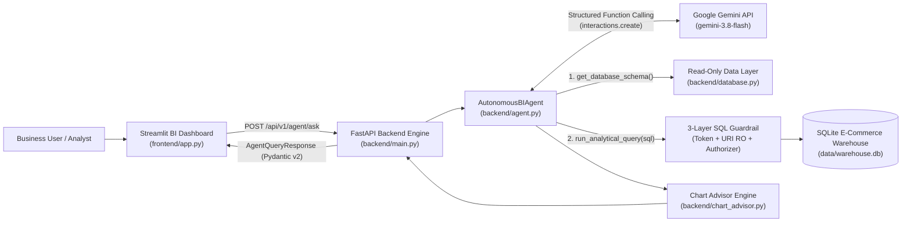
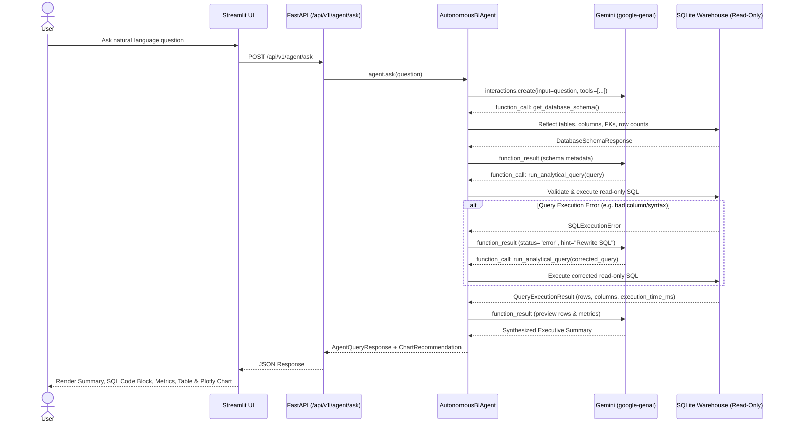
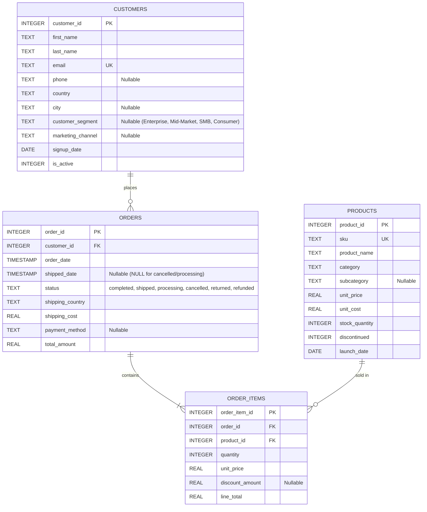

# Autonomous BI & Data Analysis Agent (Text-to-SQL + Insights)

[](.github/workflows/ci.yml)
[](pyproject.toml)
[](backend/main.py)
[](frontend/app.py)
[](backend/agent.py)
[](pyproject.toml)

A production-ready, full-stack **Autonomous Business Intelligence & Data Analysis Agent** that translates natural-language business questions into validated read-only ANSI/SQLite queries, self-heals execution errors automatically, and delivers executive insights paired with automated **Plotly** visualizations.

---

## Key Capabilities

- **Autonomous Agentic Text-to-SQL Loop (`google-genai` Interactions API):**
  - Uses structured Function Calling with two deterministic tools: `get_database_schema()` and `run_analytical_query(query: str)`.
  - Always inspects table definitions, column types, and foreign keys before generating SQL.
  - Automatically catches SQLite compilation or column errors, feeds diagnostic hints back into the interaction loop, and rewrites the SQL query until execution succeeds.
- **Defense-in-Depth Read-Only SQL Guardrails:**
  - **Layer 1 (Lexical & Token Validator):** Strips comments (`--`, `/* */`), blocks stacked multi-statement queries (`;`), enforces `SELECT` / `WITH` / `EXPLAIN` entry points, and rejects all DDL/DML/administrative tokens (`DROP`, `DELETE`, `UPDATE`, `INSERT`, `ALTER`, `TRUNCATE`, `CREATE`, `REPLACE`, `ATTACH`, `DETACH`, `PRAGMA`, `VACUUM`).
  - **Layer 2 (SQLite URI Read-Only Mode):** Opens database connections via `file:...?mode=ro` and sets `PRAGMA query_only = ON`.
  - **Layer 3 (SQLite C-Engine Authorizer):** Registers `conn.set_authorizer(...)` to deny any operation outside `SQLITE_SELECT`, `SQLITE_READ`, `SQLITE_FUNCTION`, and `SQLITE_RECURSIVE`.
- **Automated Chart Advisor:**
  - Inspects result cardinality and column types (temporal, categorical, quantitative) to automatically recommend and render **Line**, **Bar**, **Donut/Pie**, **Scatter**, or **KPI Metric** visualizations in Plotly.
- **Interactive Dark/Light Streamlit Dashboard:**
  - Displays the natural-language prompt, formatted SQL block, execution telemetry (`ms`), interactive dataframe, automated Plotly chart, tool execution trace, and a live **Warehouse Schema Explorer**.

---

## System Architecture

### End-to-End Component & Agentic Workflow



### Self-Healing Text-to-SQL Sequence



---

## Data Warehouse Schema (`data/warehouse.db`)

The deterministic seed script (`scripts/seed_db.py`) populates a normalized e-commerce data warehouse spanning **8 quarters (2025 Q1 – 2026 Q4)** with realistic analytical edge cases (`NULL` customer segments/phones/discounts, `cancelled`/`returned`/`refunded` orders, and discontinued SKUs).



---

## Project Structure

```text
.
├── .github/workflows/
│   └── ci.yml                          # GitHub Actions CI (Ruff + Pytest + Coverage)
├── backend/
│   ├── __init__.py
│   ├── agent.py                        # Gemini Interactions API function-calling BI agent
│   ├── chart_advisor.py                # Automated Plotly chart recommendation heuristics
│   ├── config.py                       # Pydantic Settings configuration
│   ├── database.py                     # 3-layer read-only SQLite guardrails & schema reflection
│   ├── main.py                         # FastAPI application and REST endpoints
│   └── schemas.py                      # Strict Pydantic v2 request/response models
├── data/
│   └── warehouse.db                    # Seeded SQLite E-Commerce data warehouse
├── frontend/
│   ├── __init__.py
│   └── app.py                          # Streamlit dark/light executive BI dashboard
├── scripts/
│   ├── __init__.py
│   └── seed_db.py                      # Deterministic warehouse generator with edge cases
├── tests/
│   ├── conftest.py                     # Session-scoped DB & FastAPI TestClient fixtures
│   ├── test_agent_and_charts.py        # Unit tests for agent self-healing & chart advisor
│   ├── test_api_routes.py              # Integration tests for all FastAPI endpoints
│   └── test_database_and_security.py   # Parameterized SQL injection/DDL/DML security tests
├── .dockerignore
├── .env.example
├── .gitignore
├── Dockerfile                          # Multi-stage production Dockerfile
├── docker-compose.yml                  # Orchestrates backend (:8000) and frontend (:8501)
├── pyproject.toml                      # Project metadata, Ruff, and Pytest configuration
└── requirements.txt
```

---

## Quickstart & Setup Instructions

### Option 1: Local Python Environment

1. **Clone the repository and install dependencies:**
   ```bash
   pip install -r requirements.txt
   ```

2. **Configure environment variables:**
   ```bash
   cp .env.example .env
   # Edit .env and set GEMINI_API_KEY=your_actual_key
   ```
   *(Note: If `GEMINI_API_KEY` is omitted, the agent automatically operates in deterministic local analytical mode so the UI and test suite work out-of-the-box.)*

3. **Seed the SQLite Data Warehouse:**
   ```bash
   python -m scripts.seed_db
   ```

4. **Start the FastAPI Backend Server (Terminal 1):**
   ```bash
   uvicorn backend.main:app --host 0.0.0.0 --port 8000 --reload
   ```
   Open `http://localhost:8000/docs` for interactive Swagger OpenAPI documentation.

5. **Launch the Streamlit Dashboard (Terminal 2):**
   ```bash
   streamlit run frontend/app.py
   ```
   Open `http://localhost:8501` in your browser.

---

### Option 2: Docker Compose (Full Stack)

```bash
export GEMINI_API_KEY="your_gemini_api_key"
docker compose up --build
```

- **FastAPI Backend & OpenAPI Docs:** `http://localhost:8000/docs`
- **Streamlit BI Dashboard:** `http://localhost:8501`

---

## REST API Reference

| Method | Endpoint | Description |
| :--- | :--- | :--- |
| `GET` | `/api/v1/health` | Service readiness, SQLite table count, and Gemini configuration status |
| `GET` | `/api/v1/schema` | Full warehouse schema (`customers`, `orders`, `order_items`, `products`) |
| `POST` | `/api/v1/query/validate` | Validates whether a candidate SQL string is strictly read-only |
| `POST` | `/api/v1/query/sql` | Executes a validated read-only SQL query and returns rows + chart suggestion |
| `POST` | `/api/v1/agent/ask` | Runs the autonomous Text-to-SQL + Insights agent loop |

### Example Request: `POST /api/v1/agent/ask`

```bash
curl -X POST "http://localhost:8000/api/v1/agent/ask" \
  -H "Content-Type: application/json" \
  -d '{
    "question": "What is our net revenue and gross profit breakdown by product category?"
  }'
```

---

## Sample Analytical Queries

1. **Quarterly Revenue & Order Volume Trend (`LINE` chart):**
   > *"Show quarterly revenue and total orders trend across all quarters."*
2. **Product Category Profitability (`BAR` chart):**
   > *"What is our net revenue and gross profit breakdown by product category?"*
3. **Order Status & Cancellation Rate Analysis (`PIE` chart):**
   > *"Analyze order status distribution including cancellation and return rates."*
4. **Customer Segment Performance (`BAR` chart, handling `NULL` segments via `COALESCE`):**
   > *"Compare customer count, net revenue, and average order value by customer segment."*
5. **Top 10 Best-Selling SKUs by Net Sales & Gross Profit (`BAR` chart):**
   > *"Which are the top 10 products by net sales and gross profit?"*

---

## Testing & Code Quality

Run the linter (`ruff`) and the full unit/integration test suite (`pytest` with coverage):

```bash
# Lint and check formatting
python -m ruff check .

# Execute unit & integration tests with coverage report
python -m pytest --cov=backend --cov=scripts --cov-report=term-missing
```
